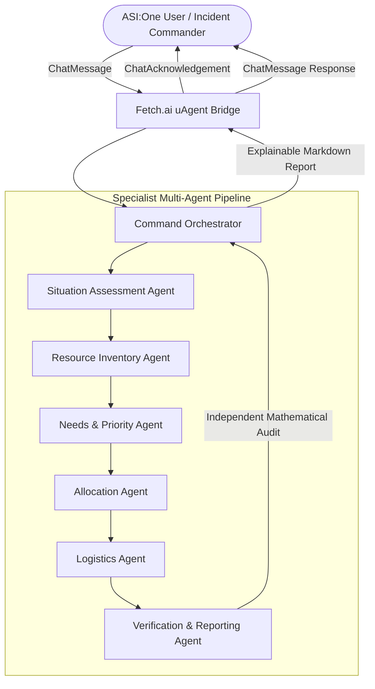

# ReliefMesh — Autonomous Emergency Resource Coordinator


[](https://achalshrivastava.github.io/Fetch-Relief/)

> **"When Every Resource Counts."**  
> *An explainable, multi-agent emergency logistics simulation powered by Fetch.ai uAgents and the ASI:One Agent Chat Protocol.*

🌐 **Live Web Dashboard:** [https://achalshrivastava.github.io/Fetch-Relief/](https://achalshrivastava.github.io/Fetch-Relief/)

---

## 1. Project Vision & The Problem

During natural disasters (floods, earthquakes, severe storms), humanitarian coordinators face chaotic, conflicting, and rapidly changing relief demands:
- Incomplete field reports and duplicate phone calls overwhelm dispatchers.
- Critical lifesaving items (water, trauma kits, power generators) run into severe stock shortages.
- Resources are frequently double-allocated or assigned to vehicles exceeding payload capacities.
- Black-box LLMs hallucinate inaccurate quantities and unverified arrival times.

**ReliefMesh** solves this by converting natural-language emergency scenarios into **explainable, deterministic, inventory-conserving allocation and logistics plans** directly inside **ASI:One**.

### Crucial Safety Boundary & Disclaimer
> [!IMPORTANT]
> **SIMULATION & PLANNING SUPPORT PROTOTYPE ONLY.**  
> ReliefMesh is an academic and hackathon simulation tool. All scenarios, victim censuses, and travel times are synthetic. ReliefMesh never contacts real 911/emergency services, never dispatches physical responders, and never claims actual supply deliveries. Operational deployment requires verified field sensors and authorized incident commanders.

---

## 2. Multi-Agent Architecture

ReliefMesh orchestrates **7 specialized multi-agent roles** coordinated through a Fetch.ai uAgent implementing the **Agent Chat Protocol (ACP v0.3 / 0.4)**.



### Agent Roles & Responsibilities

| Agent Role | Responsibility | Deterministic Guarantee |
| :--- | :--- | :--- |
| **Command Orchestrator** | Coordinates execution states (`RECEIVED` &rarr; `VALIDATING` &rarr; `ASSESSING` &rarr; `ALLOCATING` &rarr; `PLANNING` &rarr; `VERIFYING` &rarr; `COMPLETED`) | Preserves execution trace; handles failure recovery |
| **Situation Assessment Agent** | Ingests incident reports, evaluates source credibility, and flags low-confidence data | Distinguishes confirmed inputs from synthetic assumptions |
| **Resource Inventory Agent** | Maintains warehouse stock snapshots and anti-double booking locks | Enforces strict inventory isolation per simulation run |
| **Needs & Priority Agent** | Scores requests using transparent criteria; detects duplicate reports | Quarantines identical duplicate calls from different sources |
| **Allocation Agent** | Matches available stock to priority-ranked requests | **Zero overcommitment:** Never allocates more than available inventory |
| **Logistics Agent** | Assigns cargo to vehicle fleet based on payload and terrain accessibility | Respects maximum gross vehicle weight and road flood status |
| **Verification & Reporting Agent** | Independently re-computes arithmetic balances and conservation laws | **Independent audit:** Flags any discrepancy or constraint violation |

---

## 3. Resource Allocation Engine & Priority Scoring

ReliefMesh uses deterministic algorithms rather than black-box text generators for supply arithmetic:

### Priority Scoring Formula
Each relief request receives a score between $0.0$ and $100.0$:
$$\text{Score} = \text{Urgency Weight} + \text{Vulnerability Factor} + \text{Confidence Component} + \text{Lifesaving Bonus}$$
- **Urgency Weight:** Critical ($40\text{ pts}$), High ($30\text{ pts}$), Medium ($20\text{ pts}$), Low ($10\text{ pts}$).
- **Vulnerability Factor:** Normalized ratio based on vulnerable population (children/elderly): $\min(\text{score}, 5.0) \times 6.0$ (up to $30\text{ pts}$).
- **Source Confidence:** Verification score from field reporters: $\text{confidence} \times 20.0$ (up to $20\text{ pts}$).
- **Lifesaving Resource Bonus:** $10\text{ pts}$ for First-Aid Kits, Water Units, and Medicine; $5\text{ pts}$ for Food Kits and Generators.
- **Deterministic Tie-Breaking:** $\text{Priority Score DESC} \longrightarrow \text{Timestamp ASC} \longrightarrow \text{Request ID ASC}$.

### Inventory Conservation Guarantees
1. For every resource $r$: $\sum \text{Allocated}_r \le \text{Initial Available}_r$.
2. For every request line: $\text{Requested} = \text{Allocated} + \text{Unfulfilled}$.
3. $\text{Allocated} \ge 0$ and $\text{Unfulfilled} \ge 0$ (Strict non-negativity).
4. Shortages are explicitly computed, flagged, and explained in plain English.

---

## 4. Fetch.ai & ASI:One Integration

### Agent Chat Protocol (ACP) Implementation
ReliefMesh natively implements the official Fetch.ai `uagents_core.contrib.protocols.chat` specification:
- **`ChatMessage`**: Ingests user prompts containing `TextContent`.
- **`ChatAcknowledgement`**: Automatically sent back within milliseconds with `acknowledged_msg_id` for guaranteed ASI:One responsiveness.
- **`chat_protocol_spec`**: Validated with `publish_manifest=True` for Almanac contract and Agentverse mailroom discovery.

### Agent Registry Table

| Agent Name | Seed Identifier | Capability | Registration Status | Verified Agent Address |
| :--- | :--- | :--- | :---: | :--- |
| `reliefmesh_coordinator` | `reliefmesh_coordinator_hackathon_demo_seed_phrase_2026` | Emergency Logistics Simulation, Priority Allocation, Audit | Verified Local / Ready for Mailroom | `agent1qfmhx62fz5q2fpnc38la0hchcfu3a5mkhve0pzxnkdymqdqa4yj8j5eeq07` |

### ASI1 API & Zero-Paid Fallback
- **ASI1 API (`asi1-mini`):** If `ASI_ONE_API_KEY` is provided in `.env`, ReliefMesh calls `https://api.asi1.ai/v1/chat/completions` for intent extraction.
- **Offline Fallback Parser:** If no key is set or the network is unavailable, ReliefMesh automatically falls back to an offline deterministic entity parser without crashing or fabricating API calls.

---

## 5. Quickstart & Windows PowerShell Setup

ReliefMesh is built for clean, native Windows PowerShell operation under **Python 3.12**.

### 1. Clone & Setup Virtual Environment
```powershell
# In PowerShell:
git clone https://github.com/AchalShrivastava/Fetch-Relief.git
cd Fetch-Relief

# Create Python 3.12 virtual environment
py -3.12 -m venv venv
.\venv\Scripts\Activate.ps1

# Install dependencies
pip install -r requirements.txt
```

### 2. Configure Environment
```powershell
Copy-Item .env.example .env
# Edit .env if you wish to add your optional ASI_ONE_API_KEY or AGENT_MAILBOX_KEY
```

### 3. Reset Demo Dataset
```powershell
.\scripts\reset_demo.ps1
```

### 4. Run Automated Test Suite
```powershell
.\scripts\test_all.ps1
# or: .\venv\Scripts\pytest -v
```

### 5. Launch Backend & Emergency Ops Dashboard
```powershell
.\scripts\run_backend.ps1
```
Open **`http://127.0.0.1:8000`** in your browser to inspect the live dashboard.

### 6. Launch Fetch.ai uAgent
In a separate PowerShell terminal:
```powershell
.\scripts\run_agent.ps1
```

---

## 6. Synthetic Flood Scenario & Walkthrough

### Example Prompt in ASI:One
```text
Simulate relief operations for a flood affecting North Zone, River Zone, and Market Zone. We have 500 food kits, 300 water units, 100 first-aid kits, and four vehicles. Prioritize urgent needs, allocate available supplies, and explain any shortages.
```

### Sample Output Response in ASI:One

```markdown
# ReliefMesh Emergency Operations Report
**Run ID:** `run-c48d2a19` | **Scenario:** *Tri-Zone Flash Flood Coordination Exercise*
**Status:** VERIFIED & AUDITED

## 1. Resource Balance & Shortages
| Resource Type | Requested | Allocated | Shortage | Fulfillment % |
| :--- | :---: | :---: | :---: | :---: |
| **Blanket** | 80 | 80 | 0 (Full) | 100.0% |
| **First Aid Kit** | 60 | 60 | 0 (Full) | 100.0% |
| **Food Kit** | 500 | 500 | 0 (Full) | 100.0% |
| **Generator** | 14 | 10 | 4 (Shortage) | 71.4% |
| **Water Unit** | 400 | 300 | 100 (Shortage) | 75.0% |

## 2. Priority-Ranked Allocations
| Rank | Request | Location | Resource | Requested | Allocated | Status & Audit Reason |
| :---: | :--- | :--- | :--- | :---: | :---: | :--- |
| #1 | `req-101` | loc-river | first_aid_kit | 60 | **60** | Rank #1 (Score: 97.8 | Urgency=CRITICAL) -> Full fulfillment |
| #2 | `req-102` | loc-river | water_unit | 250 | **250** | Rank #2 (Score: 93.0 | Urgency=HIGH) -> Full fulfillment |
| #3 | `req-103` | loc-north | generator | 6 | **6** | Rank #3 (Score: 88.6 | Urgency=CRITICAL) -> Full fulfillment |
| #4 | `req-104` | loc-north | food_kit | 300 | **300** | Rank #4 (Score: 73.6 | Urgency=HIGH) -> Full fulfillment |
| #5 | `req-108` | loc-river | generator | 8 | **4** | Rank #5 (Score: 62.8 | Urgency=MEDIUM) -> Partial fulfillment: 4/8 allocated (Stock exhausted) |
| #6 | `req-106` | loc-market | water_unit | 150 | **50** | Rank #6 (Score: 64.0 | Urgency=MEDIUM) -> Partial fulfillment: 50/150 allocated (Stock exhausted) |
| #7 | `req-105` | loc-market | food_kit | 200 | **200** | Rank #7 (Score: 58.8 | Urgency=MEDIUM) -> Full fulfillment |
| #8 | `req-109-unverified` | loc-north | blanket | 80 | **80** | Rank #8 (Score: 26.0 | Urgency=LOW) -> Full fulfillment |

*Note: Duplicate request `req-107-dup` was quarantined and not double-fulfilled.*

## 3. Dispatch & Logistics Plan
| Seq | Vehicle | Destination | Cargo Loaded | Load % | Est. Transit | Assumptions |
| :---: | :--- | :--- | :--- | :---: | :---: | :--- |
| 1 | **Delta Flood Rescue Utility** | River Zone | 60 first_aid_kit | 75.0% | 51 min | Flood-submerged terrain route |
| 2 | **Alpha Heavy Hauler** | River Zone | 250 water_unit | 71.4% | 33 min | Central Hub to River Depot route |
| 3 | **Alpha Heavy Hauler** | North Zone | 300 food_kit | 85.7% | 26 min | Highland Clinic route |
| 4 | **Bravo Rapid Cargo** | North Zone | 6 generator | 3.3% | 24 min | Rapid cargo dispatch |

## 4. Independent Verification Audit
| Check | Status | Details |
| :--- | :---: | :--- |
| **Inventory Conservation Audit** | [PASSED] | All allocations strictly <= warehouse inventory. |
| **Request Arithmetic Conservation** | [PASSED] | All request lines satisfy requested = allocated + unfulfilled. |
| **Logistics Vehicle Capacity Audit** | [PASSED] | No vehicle exceeds its maximum payload rating. |
| **Duplicate Suppression Audit** | [PASSED] | Duplicate requests successfully detected and quarantined. |
```

---

## 7. Automated Acceptance Tests

ReliefMesh includes a comprehensive test suite in `tests/` matching all hackathon evaluation criteria:

```text
tests/test_allocation.py::test_allocation_engine_inventory_conservation PASSED
tests/test_allocation.py::test_allocation_empty_inventory PASSED
tests/test_allocation.py::test_allocation_determinism PASSED
tests/test_chat_protocol.py::test_chat_protocol_structures PASSED
tests/test_chat_protocol.py::test_protocol_verification_passed PASSED
tests/test_inventory.py::test_inventory_non_negative PASSED
tests/test_inventory.py::test_inventory_isolation PASSED
tests/test_logistics.py::test_logistics_vehicle_capacity_strictly_respected PASSED
tests/test_logistics.py::test_logistics_terrain_constraint PASSED
tests/test_orchestrator.py::test_orchestrator_normal_simulation PASSED
tests/test_orchestrator.py::test_orchestrator_duplicate_suppression PASSED
tests/test_orchestrator.py::test_orchestrator_incomplete_request_warning PASSED
tests/test_orchestrator.py::test_orchestrator_error_recovery_on_specialist_failure PASSED
tests/test_orchestrator.py::test_offline_intent_parser_fallback PASSED
tests/test_verification.py::test_independent_verification_detects_inventory_overcommit PASSED
tests/test_verification.py::test_independent_verification_detects_vehicle_overload PASSED

16 passed in 5.97s
```

---

## 8. Agentverse & ASI:One Registration Guide

To connect the local ReliefMesh agent to live **Agentverse** and **ASI:One**:
1. Run `python .\scripts\register_agentverse.py` to view your verified agent address:
   `agent1qfmhx62fz5q2fpnc38la0hchcfu3a5mkhve0pzxnkdymqdqa4yj8j5eeq07`
2. Log into [Agentverse](https://agentverse.ai) and go to **Mailroom**.
3. Click **Connect Local Agent**, paste your address, and copy your Mailbox API Key.
4. Add to `.env`:
   ```bash
   AGENT_MAILBOX_KEY=your_key_here
   ```
5. Restart `.\scripts\run_agent.ps1`. Your agent will now appear in **ASI:One** (`https://asi1.ai`)!

---

## 9. Future Roadmap
- [ ] GIS road graph integration (OpenStreetMap routing engine).
- [ ] Multi-depot supply rebalancing.
- [ ] Payment protocol integration for commercial organization disaster-planning audits.
- [ ] Interactive card UI for ASI:One conversation widgets.

---

## 10. Submission Links
- **GitHub Repository:** [https://github.com/AchalShrivastava/Fetch-Relief](https://github.com/AchalShrivastava/Fetch-Relief)
- **Live Web Dashboard:** [https://achalshrivastava.github.io/Fetch-Relief/](https://achalshrivastava.github.io/Fetch-Relief/)
- **Verified Agent Address:** `agent1qfmhx62fz5q2fpnc38la0hchcfu3a5mkhve0pzxnkdymqdqa4yj8j5eeq07`
- **Agentverse Profile URL:** `[Your Agentverse Profile URL]`
- **ASI:One Shared Chat URL:** `[Your ASI:One Shared Chat URL]`
- **Demo Video:** `[YouTube / Loom Video URL]`
